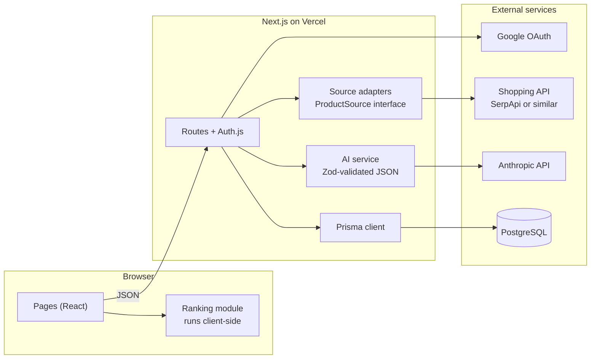

# DealPilot — Architecture and Data Schema

Nov 25, 2026 · Weisi Chen

## System architecture

DealPilot is one Next.js app on Vercel: the browser renders pages and re-ranks results locally, while server route handlers call the shopping API, the Anthropic API and PostgreSQL.



Only the server holds API keys; the browser receives normalized listings as JSON and does all re-ranking itself.

**Key decisions**

- Ranking is a pure function in `lib/ranking`, shared by the client and tests, so weight changes need no network call.
- Every product source sits behind the `ProductSource` adapter interface and returns the same `Listing` shape.
- All API inputs and model outputs are validated with Zod at the boundary.
- Server Components fetch data; Client Components handle sliders, compare selection and hearts.
- Compare selection lives in the URL (`/compare?ids=`), so compare pages are shareable and testable.

## Tech stack

| Layer | Choice |
| --- | --- |
| Framework | Next.js (App Router), TypeScript strict mode |
| UI | Tailwind CSS, tokens from `docs/design/DESIGN.md` |
| Database | PostgreSQL with Prisma ORM |
| Auth | Auth.js (Google OAuth, email magic link) |
| AI | Anthropic API (multimodal), Zod-validated JSON output |
| Product data | Third-party Google Shopping results API via adapters |
| Testing | Vitest, fast-check, Stryker, Playwright, axe |
| Hosting and CI/CD | Vercel (preview and production), GitHub Actions |

## API routes

All routes are Next.js route handlers; every input is validated with Zod and every protected route checks the session server-side.

| Method and path | Access | Purpose |
| --- | --- | --- |
| `POST /api/extract` | Public, rate-limited | Image and text → attributes and search queries |
| `POST /api/search` | Public, rate-limited | Queries → normalized listings (cached 30 min) |
| `POST /api/explain` | Public | Scores and listings → explanations and compare summary |
| `GET /api/wishlist` · `POST` · `DELETE /api/wishlist/:id` | Shopper (own items only) | Read, add and remove wishlist items |
| `GET /api/history` | Shopper | Last 10 searches |
| `PATCH /api/me/weights` | Shopper | Save default weights |
| `POST /api/flags` | Shopper | Flag a wrong match |
| `GET /api/admin/usage` · `PATCH /api/admin/sources/:platform` · `GET /api/admin/flags` | Admin | Usage, source toggles, flagged matches |
| `/api/auth/*` | Public | Auth.js sign-in and session |

## Data schema

Seven application tables live in PostgreSQL alongside the standard Auth.js tables (Account, Session, VerificationToken). Listings themselves are not stored, except as snapshots in wishlist items and cached search payloads.

| Entity | Purpose | Key constraints |
| --- | --- | --- |
| User | Account, role and default weights | Unique email; role defaults to SHOPPER |
| WishlistItem | Saved listing snapshot with original URL | Unique (userId, url); cascade on user delete |
| SearchHistory | Recent searches per user | Trimmed to the last 10 per user |
| SearchCache | Cached search responses | Unique queryHash; expires after 30 minutes |
| SourceConfig | Platform on/off switch | One row per platform |
| ApiUsage | Daily calls and estimated cost per source | Unique (source, date) |
| MatchFlag | Shopper reports of wrong matches | Status OPEN or RESOLVED |

```prisma
enum Role { SHOPPER ADMIN }
enum Platform { AMAZON EBAY WALMART BEST_BUY TARGET OTHER }
enum FlagStatus { OPEN RESOLVED }

model User {
  id             String          @id @default(cuid())
  email          String          @unique
  name           String?
  role           Role            @default(SHOPPER)
  defaultWeights Json?           // { price, quality, popularity }
  createdAt      DateTime        @default(now())
  accounts       Account[]
  sessions       Session[]
  wishlist       WishlistItem[]
  searches       SearchHistory[]
  flags          MatchFlag[]
}

model WishlistItem {
  id          String   @id @default(cuid())
  userId      String
  user        User     @relation(fields: [userId], references: [id], onDelete: Cascade)
  platform    Platform
  url         String
  title       String
  imageUrl    String?
  priceAtSave Decimal  @db.Decimal(10, 2)
  priceNow    Decimal? @db.Decimal(10, 2)
  snapshot    Json     // normalized Listing at save time
  savedAt     DateTime @default(now())

  @@unique([userId, url])
}

model SearchHistory {
  id         String   @id @default(cuid())
  userId     String
  user       User     @relation(fields: [userId], references: [id], onDelete: Cascade)
  query      String
  attributes Json
  createdAt  DateTime @default(now())

  @@index([userId, createdAt])
}

model SearchCache {
  queryHash String   @id
  payload   Json     // Listing[]
  expiresAt DateTime

  @@index([expiresAt])
}

model SourceConfig {
  platform  Platform @id
  enabled   Boolean  @default(true)
  updatedBy String?
  updatedAt DateTime @updatedAt
}

model ApiUsage {
  id         String   @id @default(cuid())
  source     String
  date       DateTime @db.Date
  calls      Int      @default(0)
  estCostUsd Decimal  @default(0) @db.Decimal(10, 4)

  @@unique([source, date])
}

model MatchFlag {
  id         String     @id @default(cuid())
  userId     String
  user       User       @relation(fields: [userId], references: [id], onDelete: Cascade)
  listingUrl String
  reason     String
  status     FlagStatus @default(OPEN)
  createdAt  DateTime   @default(now())
}

// Account, Session and VerificationToken follow the standard Auth.js Prisma adapter schema.
```
